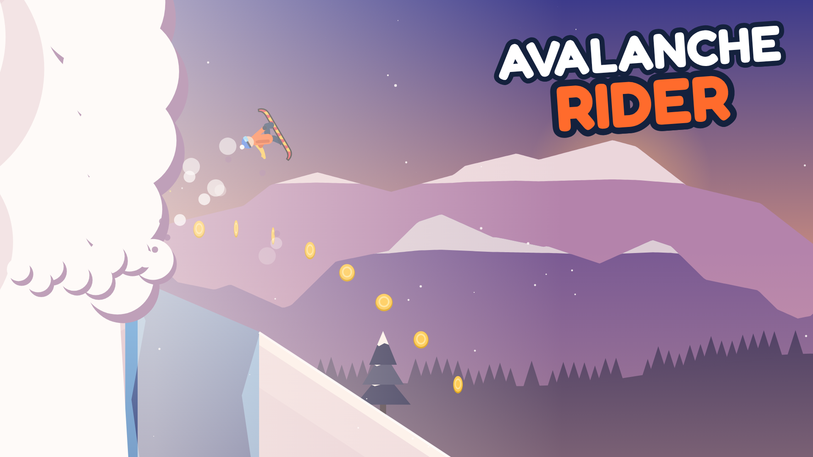
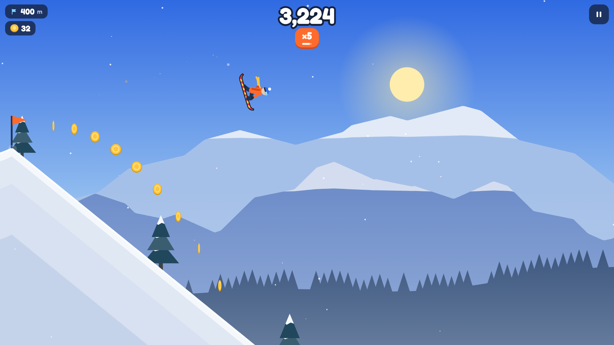
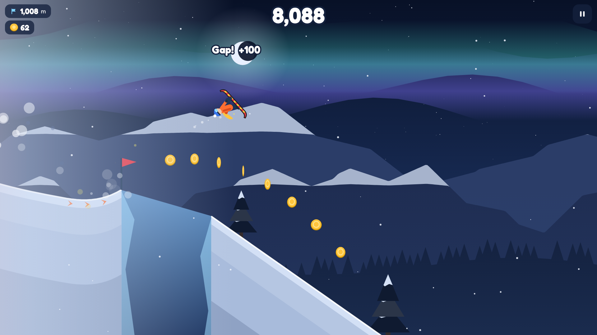
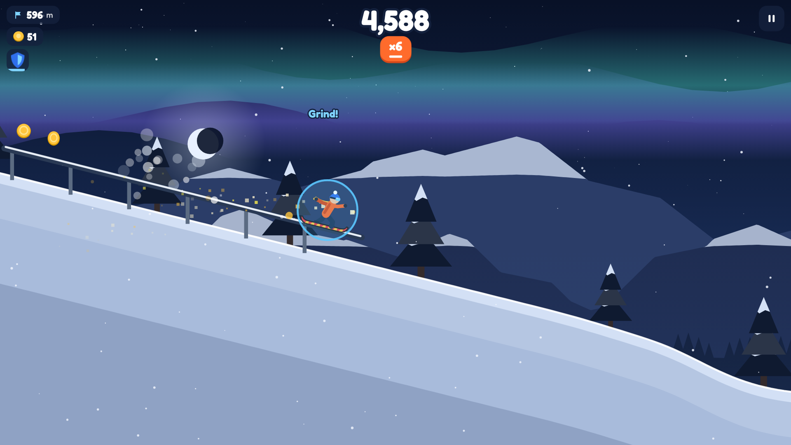
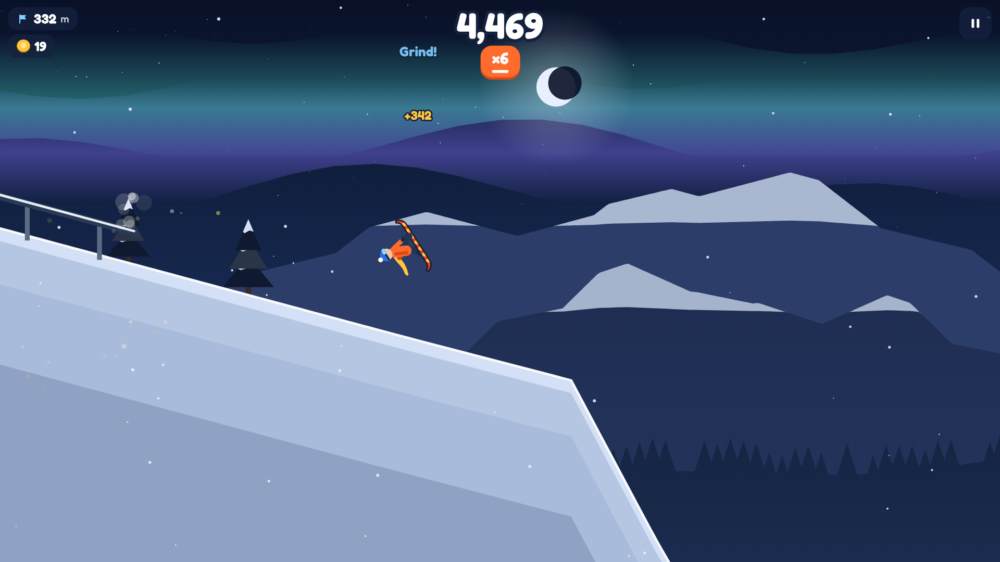
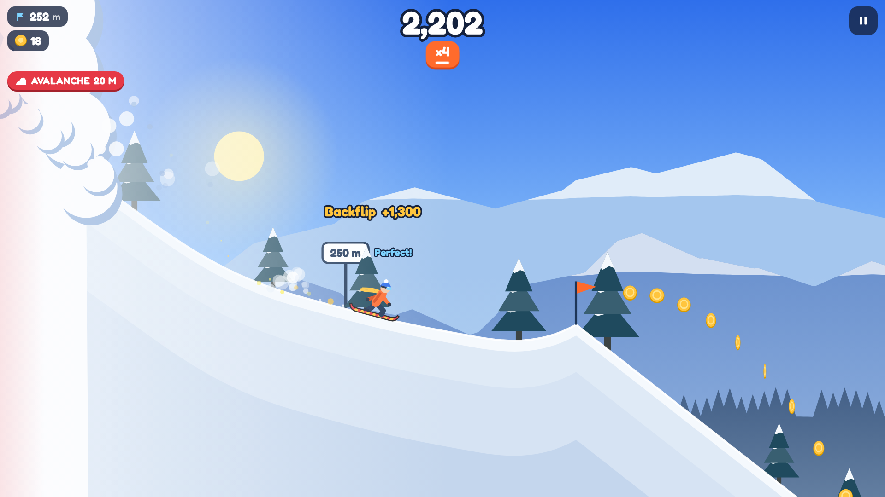
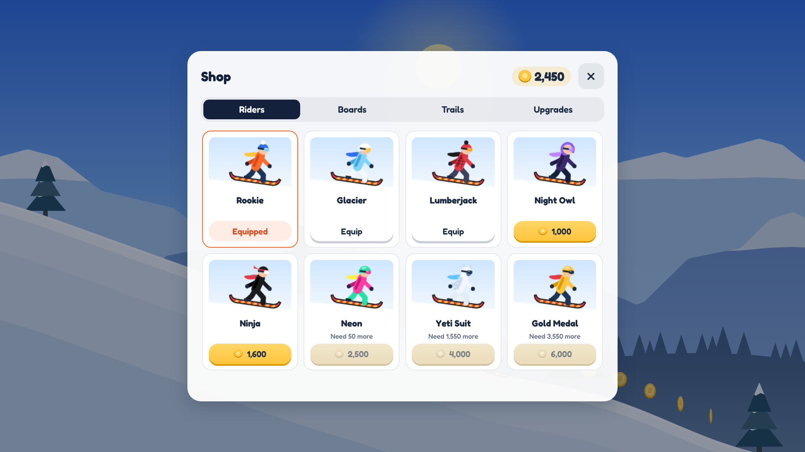

# Avalanche Rider



**Avalanche Rider** ist ein Snowboard-Arcade-Spiel für den Browser, gebaut für die Spieleplattform [CrazyGames](https://www.crazygames.com). Du rast einen endlosen Berg hinunter, springst über Schanzen und Gletscherspalten, grindest Rails, zeigst Rückwärtssaltos und fährst einer Lawine davon. Es gibt nur **eine Taste**: drücken = springen, in der Luft halten = Salto.

Alles ist selbst gebaut: Engine (Canvas 2D), Grafiken, Musik und Sounds (live mit der Web Audio API erzeugt). Einziges Fremd-Asset ist die Schrift Fredoka (SIL Open Font License 1.1, `fonts/OFL.txt`). Das komplette Spiel ist **0,22 MB** groß (20 Dateien).

| | |
|---|---|
|  |  |
|  |  |
|  |  |

## Spielen

```bash
npm install          # einmalig, im Repository-Hauptordner
npm run serve        # dann http://localhost:8080/avalanche-rider/ öffnen
```

Auf `localhost` läuft das CrazyGames-SDK im lokalen Testmodus: Statt echter Werbung blendet es einen Platzhalter ein. Ohne Internet oder ohne SDK läuft das Spiel trotzdem (dann ohne Werbung).

| | Tastatur | Maus | Touch |
|---|---|---|---|
| Springen | Leertaste, ↑ oder W | Linksklick | Tippen |
| Rückwärtssalto | in der Luft gedrückt halten | gedrückt halten | Finger halten |
| Pause | P oder Esc | Pause-Knopf | Pause-Knopf |

## Spielmechanik

- **Landen:** Das Board muss beim Aufsetzen ungefähr parallel zum Hang sein. Unter 9° Abweichung gibt es eine *perfekte Landung* mit Tempo-Bonus, bis 24° eine saubere, bis 55° eine *wackelige* (Tempo weg, Combo weg). Darüber stürzt man. Wer nicht dreht, richtet sich automatisch langsam auf; wer mitten im Salto loslässt, stürzt.
- **Tricks und Combo:** Saltos (einfach bis vierfach), Big Air, perfekte Landungen, Grinds, übersprungene Gletscherspalten und zertrümmerte Felsen erhöhen den Multiplikator bis ×8. 2,6 Sekunden ohne Trick auf dem Boden oder eine wackelige Landung setzen ihn zurück.
- **Hindernisse:** Felsen (überspringen), Gletscherspalten (orange Pfeile auf der Schanze geben genug Schub), Klippen, Rails.
- **Die Lawine** rollt immer hinterher und wird mit der Strecke schneller. Wer langsam wird, wird eingeholt. Am linken Rand und im HUD siehst du, wie nah sie ist.
- **Power-ups:** Magnet (zieht Münzen an) und Schild (fängt einen Felsen oder eine Bruchlandung ab).
- **Tag und Nacht:** Während der Fahrt wechselt die Tageszeit (Tag → Abend → Nacht mit Polarlicht → Morgen); ein voller Zyklus dauert 4.000 m.
- Der Berg wird prozedural erzeugt und mit der Strecke schwieriger (steiler, mehr Felsen, breitere Spalten). Jede Schanze vor einer Spalte ist so gebaut, dass man sie schafft.

## Fortschritt (für die Spielerbindung)

- **Münzen** sammeln → **Shop**: 8 Fahrer, 6 Boards, 4 Schnee-Spuren (nur Optik) und 3 Upgrades mit je 5 Stufen (Magnet-Dauer, Schild-Dauer, Landetoleranz).
- **Missionen:** immer 3 gleichzeitig (z. B. „Lande 3 Saltos in einem Lauf“). Sind alle erledigt, steigt der Rang, es gibt Bonus-Münzen und neue, schwerere Missionen.
- **Tagesgeschenk:** jeden Tag Münzen, mit Serie bis Tag 7 steigend.
- **Rekord-Flagge** auf der Piste an deiner bisherigen Bestweite.
- Beim ersten Lauf erklärt ein kurzes Tutorial die Steuerung direkt im Spiel.

## CrazyGames-Integration

Das Spiel nutzt das [CrazyGames HTML5 SDK v3](https://docs.crazygames.com/sdk/intro/). Alle Aufrufe laufen über `js/platform.js`; fehlt das SDK, läuft das Spiel ohne Werbung weiter.

| Wann | SDK-Aufruf |
|---|---|
| Spiel lädt | `init()`, `game.loadingStart()` … `game.loadingStop()` |
| Lauf startet, Weiterfahren nach Pause/Revive | `game.gameplayStart()` |
| Pause, Sturz, Ergebnis-Screen, Menü | `game.gameplayStop()` |
| „Nochmal“ oder „Menü“ nach einem Lauf | `ad.requestAd('midgame')` – erst ab dem 2. Game Over einer Sitzung; die Häufigkeit begrenzt CrazyGames selbst |
| Nach einem Sturz: „Weiterfahren – Video ansehen“ (einmal pro Lauf, ab 150 m) | `ad.requestAd('rewarded')` |
| Ergebnis-Screen: „Münzen ×2 – Video“ | `ad.requestAd('rewarded')` |
| Neuer Rekord | `game.happytime()` |
| Speichern | `data.setItem()` / `data.getItem()` (ohne SDK: `localStorage`) |
| Ton | `game.settings.muteAudio` hat Vorrang vor den Spiel-Einstellungen |

Während einer Werbung ist das Spiel pausiert und stumm. Belohnungen gibt es nur nach `adFinished`; bei `adError` erscheint „Gerade ist kein Video verfügbar“ und es gibt nichts. Sind Werbevideos nicht möglich (Adblocker, fremde Domain), werden die Video-Knöpfe gar nicht erst angezeigt. Es gibt keinen eigenen Vollbild-Knopf und keine Links nach außen (beides verbieten die CrazyGames-Regeln).

## Ordner

| Pfad | Inhalt |
|---|---|
| `index.html`, `style.css`, `js/`, `fonts/`, `img/` | das Spiel (das kommt in die ZIP) |
| `js/platform.js` | CrazyGames-SDK-Anbindung |
| `js/terrain.js`, `js/rider.js`, `js/game.js` | Berg-Generator, Physik, Spiellogik |
| `js/render.js`, `js/audio.js` | Grafik und Ton (alles aus Code) |
| `js/content.js`, `js/progress.js` | Shop-Inhalte, Missionen, Speicherstand – hier lässt sich das Spiel am einfachsten anpassen (Preise, Missionen) |
| `store/` | alles für die Einreichung: ZIP, 3 Cover, 2 Preview-Videos, Screenshots |
| `tools/build.mjs` | baut `store/avalanche-rider-crazygames.zip` |
| `tools/store-assets.mjs` | erzeugt Cover, Screenshots und Videos aus dem echten Spiel (braucht `ffmpeg`) |
| `tools/test.mjs`, `tools/sdk-mock.js` | automatische Tests der CrazyGames-Anbindung mit einem nachgebauten SDK, plus Test, dass jede Gletscherspalte schaffbar ist |

```bash
npm run avalanche:test     # Tests (Werbe-Ablauf, Pause, Speichern, Stummschaltung, Spalten)
npm run avalanche:build    # ZIP neu bauen (nach jeder Code-Änderung)
npm run avalanche:assets   # Cover, Screenshots, Videos neu erzeugen
```

**Wichtig:** Der GitHub-Pages-Workflow veröffentlicht `avalanche-rider/` absichtlich **nicht**. Wenn du die Exklusivität bei CrazyGames wählst (siehe unten), darf das Spiel nirgendwo sonst spielbar sein.

---

## Mit CrazyGames Geld verdienen – Schritt für Schritt

> Stand der Recherche: Oktober 2026. Die offizielle Doku (docs.crazygames.com) war aus der Umgebung, in der das Spiel gebaut wurde, nicht direkt abrufbar; die Angaben stammen aus Suchergebnis-Auszügen der offiziellen Seiten und sind mit Quelle verlinkt. Angaben aus Drittquellen sind als solche markiert. Prüfe vor dem Einreichen die verlinkten Seiten selbst – Regeln und Zahlen können sich ändern.

### So funktioniert das Geld bei CrazyGames

- Du verdienst über einen **Anteil an den Werbeeinnahmen**, die dein Spiel auf CrazyGames erzeugt. Eine feste Prozentzahl veröffentlicht CrazyGames nicht; laut einer Zusammenfassung der Developer-Bedingungen wird die Auszahlung monatlich aus der Zahl der Spieler und der Werbeleistung berechnet ([portalready.world](https://portalready.world/portals/crazygames/), Drittquelle).
- **Zwei Phasen:** Zuerst kommt der **Basic Launch**: ein Test mit begrenztem Publikum, 7 bis 21 Tage, bis mindestens 500 Plays erreicht sind. In dieser Phase ist Werbung abgeschaltet – **es gibt noch kein Geld**. CrazyGames vergleicht dabei durchschnittliche Spielzeit, den Anteil der Besucher, die wirklich anfangen zu spielen, und die Wiederkehrrate mit anderen Spielen. Liegen die Werte auf oder über dem Vergleichswert, wirst du zum **Full Launch** eingeladen; erst dann ist Werbung aktiv und du bekommst Umsatzanteile ([Basic Launch Guide](https://docs.crazygames.com/resources/basic-launch-metrics/), [Requirements – Intro](https://docs.crazygames.com/requirements/intro/)). Die genauen Vergleichswerte veröffentlicht CrazyGames nicht.
- **Exklusivität (optional):** Wer das Spiel nach dem Full Launch für 2 Monate exklusiv bei CrazyGames lässt (unter den Browser-Spieleseiten), bekommt laut den Developer-Bedingungen **50 % mehr Vergütung** – so zitiert von [portalready.world](https://portalready.world/portals/crazygames/) (Drittquelle; bitte in den [aktuellen Bedingungen](https://files.crazygames.com/documents/developer_terms_20250818.pdf) nachlesen).
- **Auszahlung:** über den Zahlungsdienst Tipalti, **ab 100 € Guthaben** ([Payouts](https://docs.crazygames.com/payouts/)). Laut den Developer-Bedingungen (Stand 18.08.2025) ist die Zahlung 30 Tage nach Rechnungsstellung fällig ([Terms](https://files.crazygames.com/documents/developer_terms_20250818.pdf)).
- **Wie viel?** Dazu gibt es keine verlässlichen öffentlichen Zahlen. Es hängt von der Zahl der Plays, der Spielzeit und der Werbeleistung ab. Erwarte nichts Bestimmtes – erst der Full Launch zeigt, was das Spiel einbringt.

### Deine To-do-Liste

1. **Developer-Account anlegen** im CrazyGames Developer Portal (laut Anleitungen von Drittanbietern unter `developer.crazygames.com`).
2. **Namen prüfen:** Suche auf crazygames.com nach „Avalanche Rider“. Ich konnte nicht prüfen, ob der Name schon vergeben ist. Falls ja: Titel in `index.html` (`<title>`, die zwei `.logo`-Blöcke) und in den Covern ändern (`tools/store-assets.mjs`, Funktion `addLogo`).
3. **Lokal testen:** `npm run serve` → `http://localhost:8080/avalanche-rider/`. Einmal sterben (ab 150 m), „Weiterfahren“ drücken – im lokalen Modus zeigt das SDK statt eines Videos einen Platzhalter.
4. **ZIP hochladen:** `store/avalanche-rider-crazygames.zip` (oder neu bauen mit `npm run avalanche:build`). Technische Grenzen laut [Technical requirements](https://docs.crazygames.com/requirements/technical/): Erst-Download ≤ 50 MB (≤ 20 MB für die mobile Startseite), insgesamt ≤ 250 MB, ≤ 1.500 Dateien, nur relative Pfade. Das Spiel hat 0,22 MB und 20 Dateien.
5. **Formular ausfüllen:**
   - Titel, Beschreibung und Steuerung – Vorschlag auf Englisch steht unten.
   - **Ausrichtung:** Ich empfehle **Querformat**. Das Spiel funktioniert auch im Hochformat, dort ist die Sicht aber kleiner. CrazyGames bittet Spieler dann selbst, das Gerät zu drehen ([Technical requirements](https://docs.crazygames.com/requirements/technical/)).
   - Angeben, dass das **CrazyGames SDK** eingebaut ist.
6. **Cover und Videos hochladen** (alle in `store/`), passend zu den [Cover-Regeln](https://docs.crazygames.com/requirements/game-covers/):
   - `cover-landscape-1920x1080.png`, `cover-portrait-800x1200.png`, `cover-square-800x800.png` – einziger Text ist der Spieltitel, keine Rahmen, keine Icons.
   - `preview-landscape-1920x1080.mp4` und `preview-portrait-1080x1620.mp4` (2:3) – je 18 Sekunden, ohne Ton, Echtzeit, ohne Mauszeiger; das erste Bild ist jeweils das Cover.
7. **Im QA-/Preview-Tool testen** (laut [SDK-Doku](https://docs.crazygames.com/sdk/intro/) unter crazygames.com/preview): Werbung, Pause, Ton.
8. **Einreichen.** Das QA-Team prüft jedes Spiel. Abgelehnt wird laut [FAQ](https://docs.crazygames.com/faq/) z. B. bei Bugs, fehlendem Englisch, nicht originalen Inhalten, Inhalten über PEGI 12 oder Spielen, die sich an Kinder richten.
9. **Basic Launch abwarten** (7–21 Tage). Im Dashboard die Werte beobachten. Gute Spielzeit und Wiederkehr entscheiden über den Full Launch – Missionen, Shop und Tagesgeschenk sind genau dafür eingebaut.
10. **Full Launch annehmen.** Die SDK-Integration ist schon fertig; ab jetzt laufen Werbung und Umsatzbeteiligung.
11. **Exklusivität überlegen:** Wenn du sie wählst, das Spiel 2 Monate nirgendwo sonst spielbar machen (nicht auf GitHub Pages, itch.io, anderen Portalen).
    **Achtung:** Dieses Repository ist öffentlich (Stand Oktober 2026). Jeder kann den Spielcode herunterladen und selbst irgendwo hochladen. Wenn dir das Risiko zu groß ist, stelle das Repository auf GitHub unter *Settings → General → Danger Zone → Change visibility* auf privat. Das betrifft dann aber auch die GitHub-Pages-Seiten von Yeti Rush und Gipfelsturm (bei privaten Repositories ist GitHub Pages je nach GitHub-Tarif nicht verfügbar) – entscheide selbst.
12. **Auszahlung einrichten:** Im Developer Portal unter *Account → Billing* Adresse, Steuerdaten und Zahlungsdaten eintragen; Tipalti führt durch das passende Steuerformular ([Payouts](https://docs.crazygames.com/payouts/)).
13. **Steuern klären:** CrazyGames sitzt in Leuven, Belgien ([Wikipedia](https://en.wikipedia.org/wiki/CrazyGames)). Einnahmen musst du in Deutschland versteuern. Ob du ein Gewerbe anmelden musst, wie die Umsatzsteuer bei einem ausländischen Auftraggeber läuft und ob die Kleinunternehmerregelung passt, klärst du am besten mit einem Steuerberater – das kann ich nicht verbindlich beantworten. CrazyGames selbst gibt ebenfalls keine Steuerberatung ([Payouts](https://docs.crazygames.com/payouts/)).
14. **Dranbleiben:** Updates (neue Fahrer, Missionen, Feinschliff) halten Spieler; Shop-Preise und Missionen stehen in `js/content.js`.

### Vorschlag für die Texte im Formular (Englisch)

**Description**

> Strap in – an avalanche is right behind you! Avalanche Rider is a one-button snowboarding game on an endless mountain. Jump off kickers, hold to backflip, grind rails and launch over icy crevasses while the snow wall chases you down the slope. Chain tricks for a combo multiplier up to ×8, grab magnets and shields, and ride from sunrise into a night under the northern lights. Complete missions to rank up, earn coins and unlock riders, boards, snow trails and upgrades.

**Controls**

> Jump: Space, Arrow Up, W, left mouse button or tap
> Backflip: hold in the air – let go before you land
> Pause: P or Esc

---

## Annahmen, die ich getroffen habe

- **Neues Spiel statt Umbau:** Du hast „baue mir ein Spiel“ geschrieben, daher ist Avalanche Rider neu. Yeti Rush und Gipfelsturm liegen bereits öffentlich auf GitHub Pages; ein neues Spiel kann die Exklusivitäts-Option nutzen.
- **Thema Schnee/Snowboard,** weil das Repository „Ski-Game“ heißt.
- **Name „Avalanche Rider“** ist ein Arbeitstitel – Verfügbarkeit nicht geprüft.
- **Englisch als Standardsprache** (Deutsch wird automatisch gewählt, wenn der Browser auf Deutsch steht), weil CrazyGames Spiele ohne Englisch ablehnt.
- **Werbeplatzierung:** keine Zwischenwerbung vor dem ersten Game Over einer Sitzung, „Weiterfahren“ erst ab 150 m – damit neue Spieler nicht sofort Werbung sehen (gut für die Basic-Launch-Werte). Das kannst du in `js/game.js` (`breakAd`, `canRevive`) ändern.
- **Video-Hochformat 1080×1620:** Die Doku nennt „1080p, 2:3“; ich habe das als 1080 Pixel breit gelesen.
- **Keine In-Game-Banner:** Das SDK bietet auch Banner; ich habe sie weggelassen, um das Spielfeld frei zu halten.
